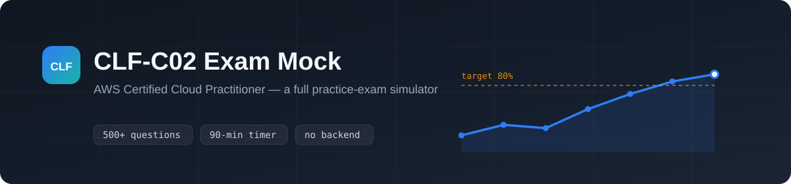

<div align="center">



<br>

**A full practice-exam simulator for the AWS Certified Cloud Practitioner (CLF-C02) exam.**
A blueprint-weighted 65-question exam mode, spaced repetition, and progress tracking —
running entirely in your browser with no account, no backend, and no tracking.

<br>


</div>

---

> **This project is under active development.** The app, engine, and study-material
> plumbing are complete and the content is landing domain by domain. Track progress in
> the table below — every row is a commit series, so the history shows exactly how the
> bank was built.

---

## What this is

The companion project to [AWS-AI-Practitioner-Exam-Mock](https://github.com/iamirtasam/AWS-AI-Practitioner-Exam-Mock)
(AIF-C01), rebuilt for the **AWS Certified Cloud Practitioner (CLF-C02)** — the current and
only bookable version of the Cloud Practitioner exam (CLF-C01 was retired in 2024).

Same architecture: no framework, no bundler, no backend. The question bank and your progress
live entirely in your browser. Progress is saved to `localStorage`; back it up from
**Settings → Export progress**.

## Exam blueprint

Built to the official CLF-C02 exam guide: **65 questions** (50 scored + 15 unscored
pretest), **90 minutes**, pass at **700/1000**, **100 USD**, valid 3 years.

| Domain | Official weight | Task statements |
|---|---|---|
| 1 · Cloud Concepts | 24% | 1.1–1.4 |
| 2 · Security and Compliance | 30% | 2.1–2.4 |
| 3 · Cloud Technology and Services | 34% | 3.1–3.8 |
| 4 · Billing, Pricing, and Support | 12% | 4.1–4.3 |

Unlike AIF-C01, the CLF-C02 guide lists only **multiple choice** and **multiple response**
item types — no ordering or matching — so the bank is built entirely from those two.

## Build progress

| Content | Target | Status |
|---|---|---|
| App shell, engine, views, tests (ported from AIF-C01) | — | ✅ Done |
| Domain 1 · Cloud Concepts (questions, notes, cards) | ~127 Qs | 🟩 Questions (127), notes, cards done |
| Domain 2 · Security and Compliance | ~158 Qs | 🟩 Questions (158), notes, cards done |
| Domain 3 · Cloud Technology and Services | ~180 Qs | 🟩 Questions (180), notes, cards done |
| Domain 4 · Billing, Pricing, and Support | ~63 Qs | 🟩 Questions (63), notes, cards done |
| Glossary, Easily Confused, Exam Day | ~179 / 30 / 1 | 🟩 Done |
| Full test suite green (`npm test`) | 113+ checks | ⬜ Pending |

## Run it

There is no build step and no server:

```bash
git clone https://github.com/iamirtasam/AWS-Cloud-Practitioner-Exam-Mock.git
cd AWS-Cloud-Practitioner-Exam-Mock
start index.html          # Windows   (macOS: open index.html · Linux: xdg-open index.html)
```

## Tests

```bash
node validate.js      # data integrity: schema, answer keys, blueprint coverage, rationale alignment
node test-engine.js   # engine logic: selection, rotation, shuffling, scoring
node test-http.js     # boots the app over real HTTP, the way it deploys
node test-ui.js       # full browser walkthrough of every screen
```

`validate.js` is the gate that runs after every content batch. The browser suites activate
their content checks once the question bank lands; the browser tests need Playwright:

```bash
npm install
npx playwright install chromium
```

## About the questions

These are **original questions written against the publicly published CLF-C02 exam guide**.
They are not real exam items, and no leaked "exam dumps" are used — dumps violate the AWS
NDA and, worse, frequently carry wrong answer keys. If you find a question whose key or
explanation looks wrong, please open an issue with the question ID shown beside the stem.

## License

[MIT](LICENSE), covering both the code and the question content.

*Not affiliated with, endorsed by, or sponsored by Amazon Web Services. "AWS" and
"AWS Certified Cloud Practitioner" are trademarks of Amazon.com, Inc. or its affiliates.*
